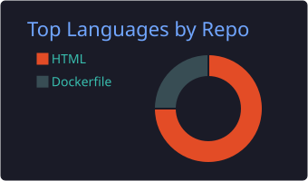
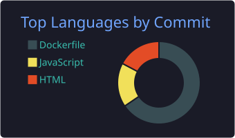
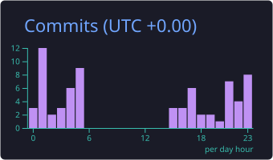

# ¡Bienvenido a mi Github! 

  Bienvenido a mi perfil de GitHub. 

-----------------------------------------------------------------------------------------------------------------------------------------------------------------------------------------------

###  Sobre mí
  Soy un desarrollador a quien le gusta la programación y la creación de proyectos nuevos mientras aprendo de nuevas tecnologías cada día.
  Actualmente estoy trabajando en proyectos propios con el uso de nuevas tecnologías.
  Asimismo, estoy aprendiendo más sobre desarrollo web y arquitectura de software.

-----------------------------------------------------------------------------------------------------------------------------------------------------------------------------------------------

### Tecnologías

### Tecnologías

-----------------------------------------------------------------------------------------------------------------------------------------------------------------------------------------------

### Mis Estadísticas de GitHub 📊

 
 

-----------------------------------------------------------------------------------------------------------------------------------------------------------------------------------------------

### Conecta conmigo
- 💼 **LinkedIn:** [Mi perfil de LinkedIn](https://www.linkedin.com/in/andr%C3%A9s-ram%C3%ADrez-rodr%C3%ADguez-5166b1335)
- 📧 **Correo:** ramrodandres672@gmail.com
