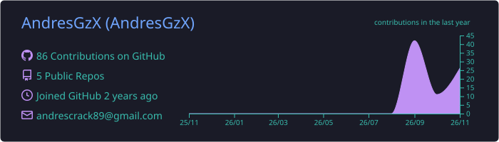
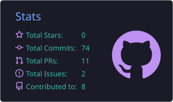

# Welcome to my GitHub!

Welcome to my GitHub profile.

  

---

### About me
I'm a developer who loves programming and creating new projects while learning about new technologies every day.
I'm currently working on personal projects using new technologies.
I'm also learning more about web development and software architecture.

---

### Technologies

---

### My GitHub Stats 📊

 
 

---

### Connect with me

